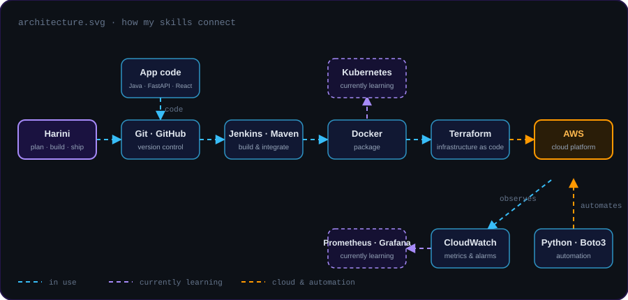
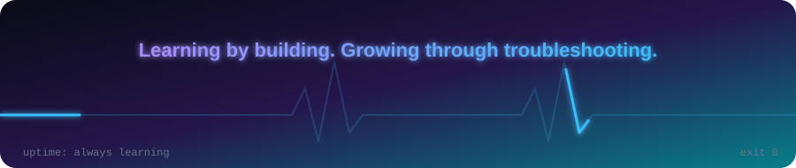

<div align="center">



<br/>


<br/><br/>

<a href="https://github.com/718harini"></a>
<a href="https://www.linkedin.com/in/sikaram-harini-73310832a/"></a>


</div>

<br/>

## `$ man harini`

```text
HARINI(1)                        Cloud Manual                        HARINI(1)

NAME
       harini - aspiring DevOps & cloud engineer

SYNOPSIS
       harini [--build] [--automate] [--deploy] [--improve]

DESCRIPTION
       MCA graduate passionate about Cloud Computing, DevOps Engineering,
       and Infrastructure Automation.

       Enjoys designing cloud infrastructure, automating repetitive tasks,
       implementing CI/CD pipelines, and building practical engineering
       projects.

OPTIONS
       --cloud        AWS cloud infrastructure
       --iac          Terraform and Infrastructure as Code
       --automate     Python and Boto3 automation
       --pipeline     CI/CD pipeline implementation
       --secure       Cloud security and monitoring
       --projects     Hands-on DevOps projects

INTERESTS
       Cloud Architecture · Automation · CI/CD Engineering
       Infrastructure Troubleshooting · Monitoring & Observability
       Cost Optimization

APPROACH
       Learn -> Build -> Test -> Troubleshoot -> Improve

SEE ALSO
       github.com/718harini
       linkedin.com/in/sikaram-harini-73310832a

Harini Sikaram                    Nov 2026                           HARINI(1)
```

<br/>

## 🔁 The Loop

<div align="center">

</div>

<br/>

## 🗺️ How My Skills Connect

<div align="center">

</div>

<br/>

## 🧰 Tech Stack

<table>
<tr>
<td width="25%" align="center"><b>☁️ Cloud & IaC</b><br/><br/></td>
<td width="25%" align="center"><b>💻 Development</b><br/><br/></td>
<td width="25%" align="center"><b>⚙️ DevOps & CI/CD</b><br/><br/></td>
<td width="25%" align="center"><b>📚 Currently Learning</b><br/><br/></td>
</tr>
</table>

<br/>

## 🚢 Deployments

```text
$ kubectl get projects

NAME                                 STACK                          STATUS
aws-enterprise-terraform-platform    AWS · Terraform · Python       Running
aws-cost-optimization-automation     Python · Boto3 · CloudWatch    Running
maven-devops-project                 Java · Maven · DevOps          Running
```

<details>
<summary><b>☁️ &nbsp;AWS Enterprise Terraform Platform</b> &nbsp;·&nbsp; <i>click to expand</i></summary>
<br/>

  

A modular AWS infrastructure management platform.

```diff
+ Infrastructure provisioning
+ AWS resource management
+ Security auditing
+ Monitoring and cost visibility
```

<a href="https://github.com/718harini/aws-enterprise-terraform-platform"></a>

</details>

<details>
<summary><b>💰 &nbsp;AWS Cost Optimization Automation</b> &nbsp;·&nbsp; <i>click to expand</i></summary>
<br/>

  

An automation project designed to audit AWS resources, analyze utilization, and identify potential cost-saving opportunities.

```diff
+ Resource auditing
+ CloudWatch metrics
+ Utilization analysis
+ Cost optimization findings
```

<a href="https://github.com/718harini?tab=repositories"></a>

</details>

<details>
<summary><b>📦 &nbsp;Maven DevOps Project</b> &nbsp;·&nbsp; <i>click to expand</i></summary>
<br/>

  

A practical project exploring application builds, dependency management, deployment workflows, and DevOps practices.

<a href="https://github.com/718harini/maven-devops-project"></a>

</details>

<br/>

## 🎯 Current Mission

```yaml
cloud_and_automation:
  - Advanced AWS architecture
  - Terraform modules
  - Python cloud automation
  - CI/CD pipelines

devops_engineering:
  - Docker & Kubernetes
  - Monitoring & observability
  - Infrastructure troubleshooting
  - Continuous improvement
```

<br/>

## 📊 GitHub Analytics

<div align="center">


<br/><br/>


<br/><br/>


</div>

<br/>

## 🤝 Let's Connect

Always happy to talk cloud, DevOps and automation, or to collaborate on something worth building.

<a href="https://www.linkedin.com/in/sikaram-harini-73310832a/"></a>
<a href="https://github.com/718harini"></a>

<br/><br/>

<div align="center">

</div>
