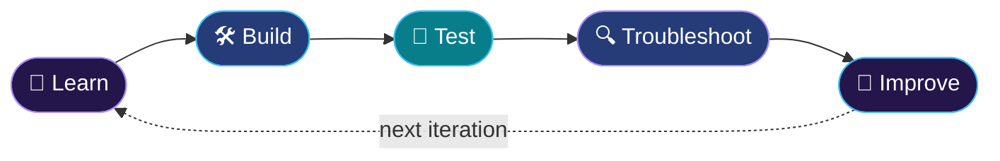

<div align="center">


<br/>

<a href="https://git.io/typing-svg"></a>

<br/>

<a href="https://github.com/718harini"></a>
<a href="https://www.linkedin.com/in/sikaram-harini-73310832a/"></a>


</div>

<br/>

## `$ whoami`

```hcl
resource "engineer" "harini" {
  role      = "Aspiring DevOps & Cloud Engineer"
  education = "MCA Graduate"

  passions  = ["Cloud Computing", "DevOps Engineering", "Infrastructure Automation"]

  focus = {
    cloud      = "AWS infrastructure & architecture"
    iac        = "Terraform modules"
    automation = "Python + Boto3"
    delivery   = "CI/CD pipelines"
    security   = "Cloud security & monitoring"
  }

  approach  = "Learn → Build → Test → Troubleshoot → Improve"
}
```

I enjoy designing cloud infrastructure, automating repetitive tasks, implementing CI/CD pipelines, and turning ideas into practical, hands-on engineering projects.

<br/>

## 🔁 How I Work



<br/>

## 🧰 Tech Stack

<table>
<tr>
<td width="25%" align="center"><b>☁️ Cloud & IaC</b><br/><br/></td>
<td width="25%" align="center"><b>💻 Development</b><br/><br/></td>
<td width="25%" align="center"><b>⚙️ DevOps & CI/CD</b><br/><br/></td>
<td width="25%" align="center"><b>📚 Currently Learning</b><br/><br/></td>
</tr>
</table>

<br/>

## 🏗️ Featured Builds

<table>
<tr>
<td width="50%" valign="top">

#### ☁️ AWS Enterprise Terraform Platform

  

A modular AWS infrastructure management platform.

```diff
+ Infrastructure provisioning
+ AWS resource management
+ Security auditing
+ Monitoring and cost visibility
```

[**View project ↗**](https://github.com/718harini/aws-enterprise-terraform-platform)

</td>
<td width="50%" valign="top">

#### 💰 AWS Cost Optimization Automation

  

Audits AWS resources, analyzes utilization, and surfaces potential cost-saving opportunities.

```diff
+ Resource auditing
+ CloudWatch metrics
+ Utilization analysis
+ Cost optimization findings
```

[**View repositories ↗**](https://github.com/718harini?tab=repositories)

</td>
</tr>
<tr>
<td colspan="2" valign="top">

#### 📦 Maven DevOps Project

  

Explores application builds, dependency management, deployment workflows, and DevOps practices.

[**View project ↗**](https://github.com/718harini/maven-devops-project)

</td>
</tr>
</table>

<br/>

## 🎯 Current Mission

| ☁️ Cloud & Automation | 🔧 DevOps Engineering |
| :-- | :-- |
| Advanced AWS architecture | Docker & Kubernetes |
| Terraform modules | Monitoring & observability |
| Python cloud automation | Infrastructure troubleshooting |
| CI/CD pipelines | Continuous improvement |

<br/>

## 📊 GitHub Analytics

<div align="center">


<br/><br/>


<br/><br/>


</div>

<br/>

## 🤝 Let's Connect

Always happy to talk cloud, DevOps, and automation, or to collaborate on something worth building.

<a href="https://www.linkedin.com/in/sikaram-harini-73310832a/"></a>
<a href="https://github.com/718harini"></a>

<div align="center">

<br/>

```text
┌──────────────────────────────────────────────────┐
│  Learning by building. Growing through           │
│  troubleshooting.                                │
└──────────────────────────────────────────────────┘
```


</div>
